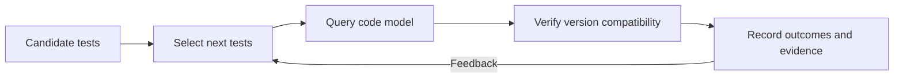
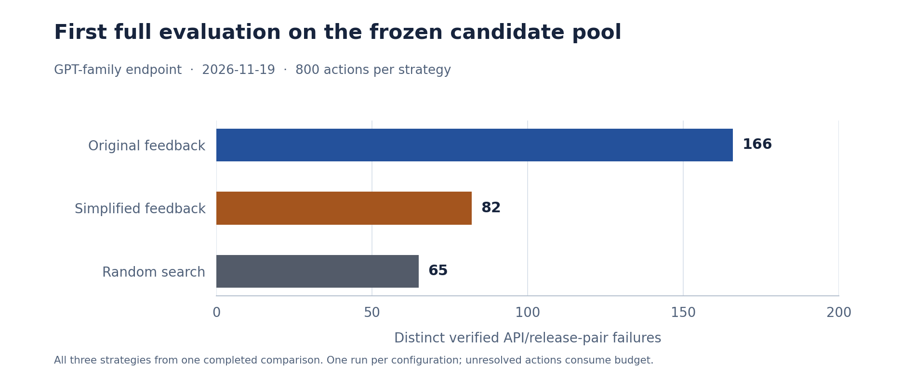

# API Version Hallucinations in LLM-Generated Code

**Feedback-guided fuzzing and version-paired evaluation for Python code models.**

Haolin Shao · Ongoing research · Selected experimental evidence from November 2026

A generated API call can use a real library yet fail with the version installed in a project. This research develops tests that expose such errors, verifies them against released APIs, and investigates how to find distinct failures within a limited testing budget.

I lead the current research design, implementation, and experiments under my advisor's supervision, building on a predecessor project. In one model's first full evaluation on our frozen candidate pool, the original feedback policy found **166 distinct verified failures versus 65 for random search**, at **800 test actions per strategy**.

[Evaluation scope](research-note.md) · [Aggregate results](data/search-results.csv) · [Runnable example](examples/check_uvicorn_binding.py)

## A concrete failure

Consider this call from a [frozen NiceGUI revision][nicegui]:

```python
Multiprocess(config, target=Server.instance.run, sockets=[sock]).run()
```

| Dependency pin | What the released API accepts |
| --- | --- |
| `uvicorn==0.40.0` | The constructor requires `target`. |
| `uvicorn==0.51.0` | The constructor no longer accepts `target`. |

I held the visible code context fixed and changed only the dependency pin. Qwen3.5-27B and DeepSeek-Coder-6.7B both retained `target` for the newer release in the recorded experiment.

Under our strict criterion, an **API version hallucination** is an actual generated call that is invalid in the requested release and valid in another real release. The included script checks the constructor boundary using the public Uvicorn packages.

## Why I redesigned the evaluation

I joined in June 2026 to audit the predecessor's experiments and reproduce parts of [VerComFix][prior]. When early evaluations detected almost no version errors, I examined the tests themselves. Of **636 assessable calls from real projects, only six distinguished the releases we compared**. An API can change while a particular call remains valid in both releases, allowing a test to pass even if the model ignores its dependency pin.

I also identified task-construction and scoring problems, including mismatches between the intended API and the call being evaluated. After discussion with my advisor and a graduate collaborator, I proposed the revised direction and took primary responsibility for developing it.

I extended the evaluator to resolve the generated call in context and require evidence from both releases. Cases with insufficient evidence remain unresolved. The revised tests make version compatibility an explicit part of what is being evaluated.

## Building a research system

I developed two connected parts of the project:

- **A version-paired evaluation framework** for constructing and reusing screened tasks, checking generated calls, recording evidence, and comparing experiments under controlled conditions.
- **A feedback-guided fuzzer** that uses completed test outcomes to choose subsequent tests under a fixed action budget.



The engineering work includes frozen configurations, resumable execution, and deduplication by actual API and ordered release pair. These support comparisons across strategies and preserve the evidence needed to revisit a result.

An early feedback policy lost to random selection. I used that result to revise the search design and evaluate subsequent policies with controlled baselines and ablations. This process made testing the value of a design choice part of the research workflow.

## A completed comparison

The displayed result is the GPT-family endpoint's first full comparison on the frozen candidate pool, following smaller prompt checks. All three strategies started with empty feedback and no shared warm-up, used the same verifier, and received the same action budget. Unresolved actions still counted toward that budget.



The figure includes all three strategies from this comparison. It reports a single preliminary run per configuration. The [evaluation note](research-note.md) records the counting unit, unresolved outcomes, and limits of the comparison. These targeted tests do not estimate the error rate in everyday code generation.

## Explore the artifact

| Resource | What it provides |
| --- | --- |
| [Evaluation note](research-note.md) | The failure criterion, comparison conditions, and scope of public reproduction. |
| [Result data](data/search-results.csv) | Final aggregate counts for all three strategies in the displayed comparison. |
| [Figure script](scripts/plot_results.py) | Regenerates the comparison figure from those counts. |
| [Uvicorn check](examples/check_uvicorn_binding.py) | Verifies the example's release boundary without running a server. |

This repository presents selected evidence from ongoing research. The full search implementation, task bank, and raw experiment records are not included. Experiments are continuing and there is no complete manuscript yet.

[nicegui]: https://github.com/zauberzeug/nicegui/blob/4c5375de1d83ba274e5d769ce7caf57293767fcd/nicegui/ui_run.py#L309
[prior]: https://doi.org/10.1145/3830085
